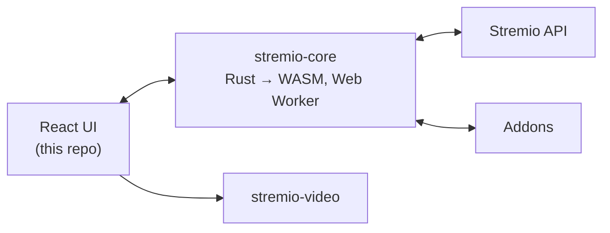

<div align="center">

<picture>
    <source media="(prefers-color-scheme: dark)" srcset="/assets/images/elenio_logo_dark.png">
    
</picture>

## Elenio web
Stremio fork so my girlfriend can have a Streamio with different themes. 

## Change theme
Go to settings and just pick a theme (Try Letterboxd Theme)

## 🛠 How it works

The UI (this repo) is a React app, but the brains live in [stremio-core](https://github.com/Stremio/stremio-core) — Stremio's Rust engine compiled to WebAssembly and running in a Web Worker. The UI renders state, the core computes it. Playback goes through [stremio-video](https://github.com/Stremio/stremio-video), which picks the right player implementation for the environment.



## 🚀 Getting started

You'll need [Node.js](https://nodejs.org) 22+ and [pnpm](https://pnpm.io/installation) 11+.

```bash
pnpm install
pnpm start
```

The dev server runs at `http://localhost:8080`.

| Command | Description |
|---|---|
| `pnpm start` | Development server with hot reload |
| `pnpm run start-prod` | Development server in production mode |
| `pnpm run build` | Production build |
| `pnpm test` | Run tests |
| `pnpm run lint` | Lint the source |
| `pnpm run scan-translations` | Check for missing translation keys |

### 🐳 Docker

```bash
docker build -t stremio-web .
docker run -p 8080:8080 stremio-web
```


## 🧩 Ecosystem

| Repository | What it is |
|---|---|
| [stremio-core](https://github.com/Stremio/stremio-core) | Rust engine: state, addon protocol, library, sync |
| [stremio-video](https://github.com/Stremio/stremio-video) | Video player abstraction used by this UI |
| [stremio-translations](https://github.com/Stremio/stremio-translations) | Community translations |
| [stremio-addon-sdk](https://github.com/Stremio/stremio-addon-sdk) | Build your own addon in Node.js |


## 📄 License

Copyright © 2017-2026 Smart Code OOD. Released under the GPL-2.0 license — see [LICENSE](/LICENSE.md).
